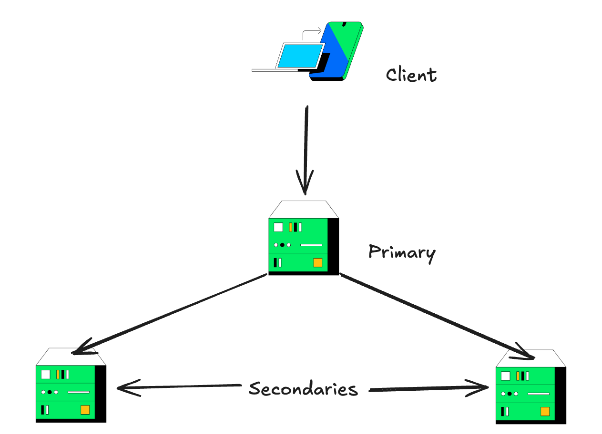
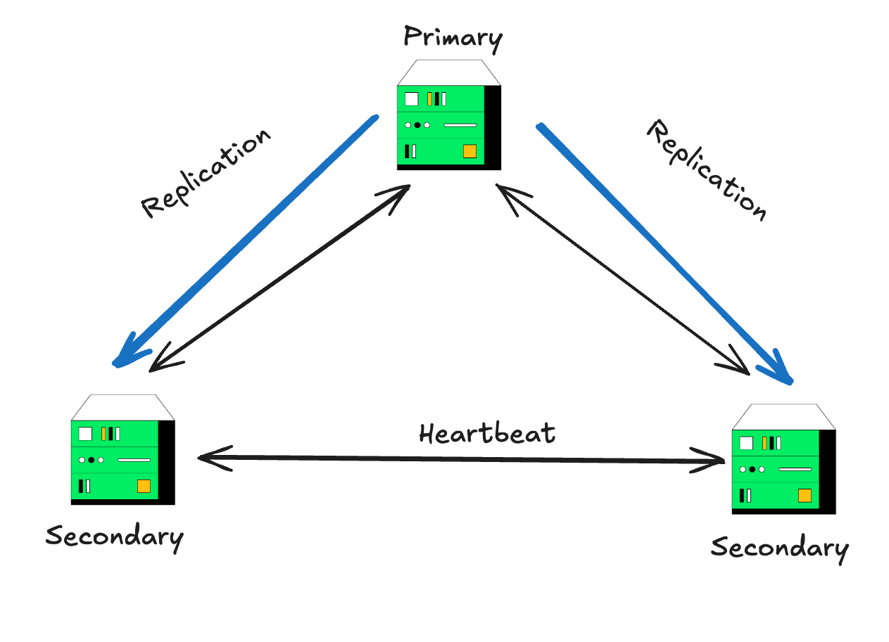
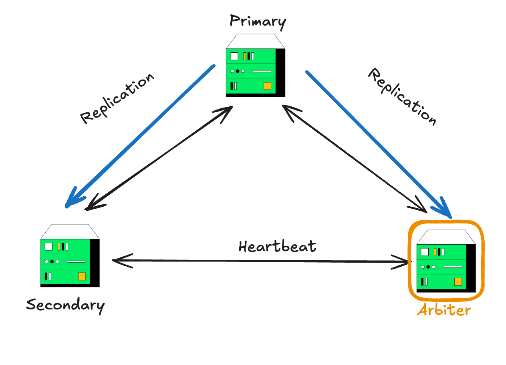
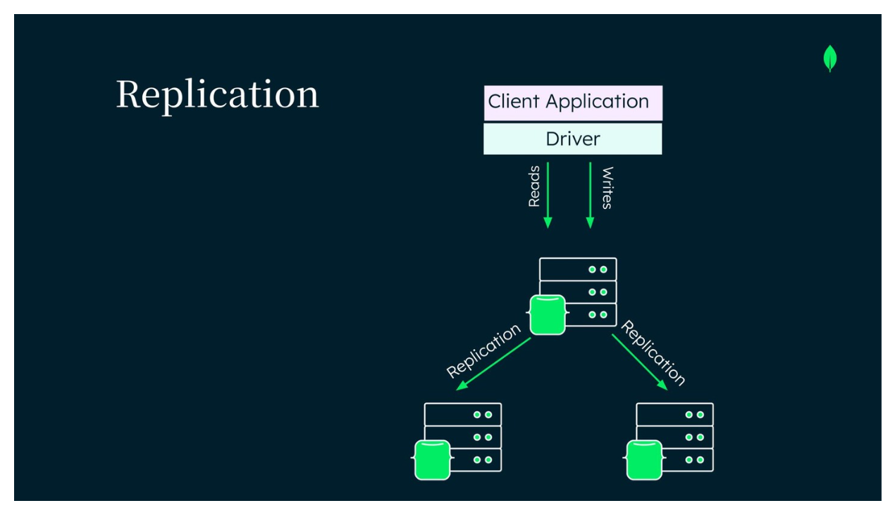

| Audio | Video | Notes |
| ----- | ----- | ----- |
| The primary node receives all write operations. A replica set can have only one primary capable of confirming writes with { w: "majority" } write concern, although in some circumstances, another mongod instance may transiently believe itself to also be primary. [1] The primary records all changes to its data sets in its operation log, that is, the oplog. For more information on primary node operation, see Replica Set Primary. |  | |
| The secondaries replicate the primary's oplog and apply the operations to their data sets such that the secondaries' data sets reflect the primary's data set. If the primary is unavailable, an eligible secondary holds an election to select a new primary. For more information on secondary members, see Replica Set Secondary Members. | |
| If cost constraints prevent adding another secondary, you may add a mongod instance to a replica set as an arbiter. An arbiter participates in elections but does not hold data (that is, does not provide data redundancy). For more information on arbiters, see Replica Set Arbiter. | |
| Secondaries replicate the primary's oplog and apply the operations to their data sets asynchronously. By having the secondaries' data sets reflect the primary's data set, the replica set can continue to function despite the failure of one or more members. |  |  |